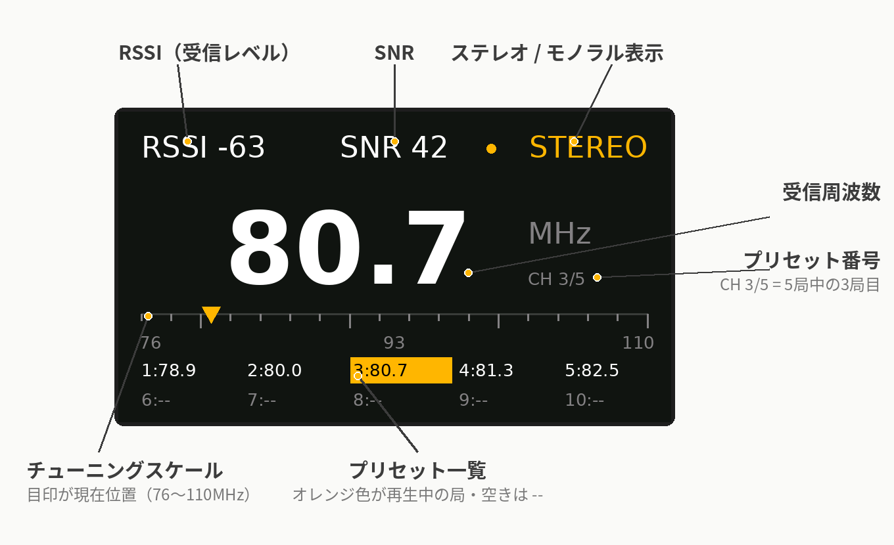
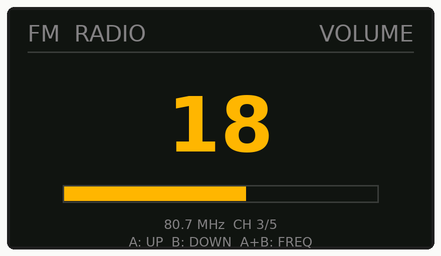
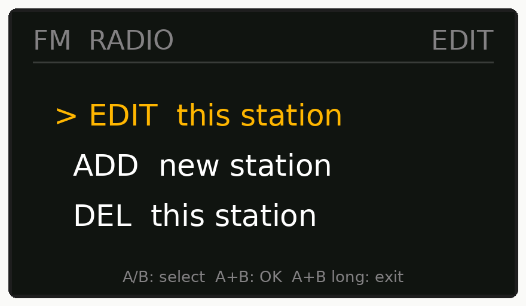
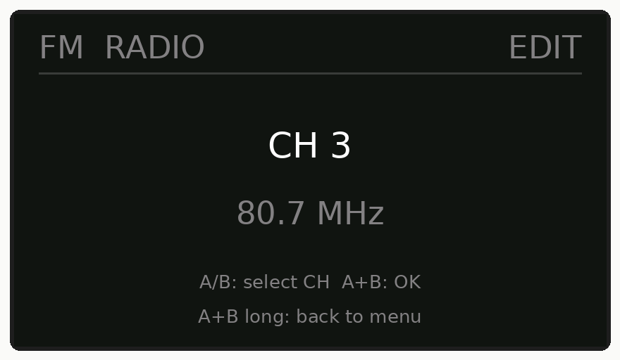
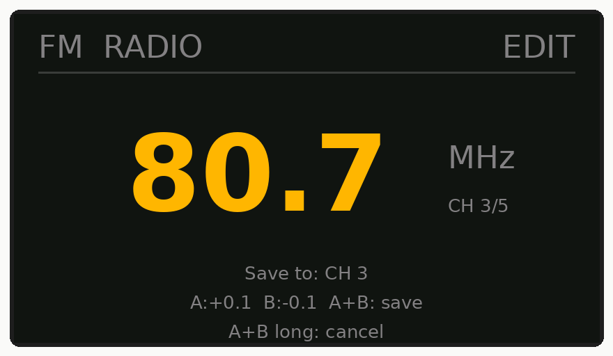
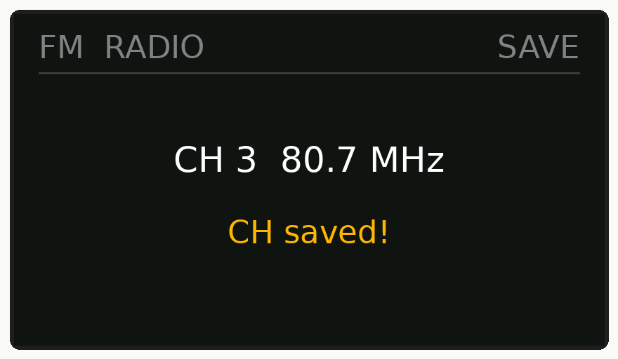
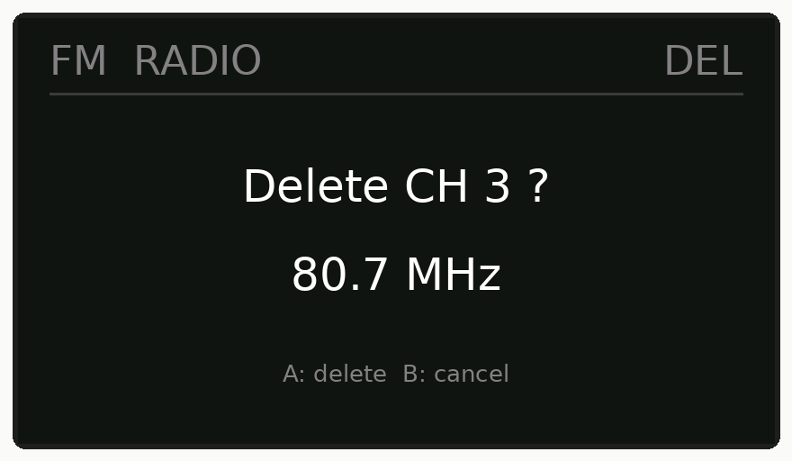

# DSP-FM Radio-module KT0937
https://massa4649.booth.pm/items/5559415 の製品説明となります。
## 概要
モジュールを制御するマイコンとのインターフェース用の端子配列は、M5StickC-PLUSのコネクタに直刺しで動作させることを考慮した設計にしています。
また、FM受信アンテナは、Φ3.5mmステレオミニジャックに接続するイアホンやオーディオケーブルのGNDラインを利用する仕様となっています。

## 選局/周波数変更
受信チャンネルの選局方法については、モジュールの４番端子をLowまたはHighにすることで周波数を上下に可変して行います。


## 音量調節
音量の調節については、可変抵抗器などの物理的なボリュームは実装していませんが、I2C制御でICの音量に関するレジスタ設定値を変更することで可変できます。

#### Arduino言語の例
```
  //smute gain: set to -36dB
  Wire.beginTransmission(DEVICE_ADDRESS);
  Wire.write(0xE3);      // Volume control
  Wire.write(0x02);      // 0x00 Mute 0x01-0x80 20log(SMUTE_GAIN/128)
  Wire.endTransmission();
  delay(100);
```

## その他
2024年3月現在においては、KT0937-D8は電子部品ショップの秋月電子さんでも販売されていますので、そちらのWEBサイトにデータシートがありますのでご参照下さい。
TOPページ：https://akizukidenshi.com/catalog/c/c0/
販売コード：113223

モジュールに実装されている水晶振動子は、デフォルトのレジスタ設定で動作するように32.768KHzを使用しています。

## 外観


## 端子配列
|Pin|Pin Name|I/O|Function|
|-----|-----|-----|-----|
|1|GND|Ground|Ground|
|2|NC|-|Non Connection|
|3|SCL|Digital I/O|SCL of 2-wire interface|
|4|INT|Analog Input|INput tuning Trigger (※connected to pin8 of KT0937-D8)|
|5|SDA|Digital I/O|SDA of 2-wire interface|
|6|NC|-|Non Connection|
|7|+3.3V|Power|Power supply (※2.1～3.6V)|
|8|NC|-|Non Connection|

## 使用例

### Arduino Uno R3 でコントロール

電源電圧に接続されたタクトスイッチを押して４番端子をHighにする事で100KHz周波数がダウンし同様にGNDに接続されたタクトスイッチを押して４番端子をLowにする事で100KHz周波数がアップします。
可変周波数範囲はICのレジスタ設定で決定します。（ICの機能としては32MHz～110MHzの受信が可能）


[](https://youtu.be/dxe-hEDnCu4)

### M5stickC Plus でコントロール

プログラミング次第ですが、周波数変更の手段としてM5stickのボタンAとボタンBを使用できます。
あらかじめ受信可能なラジオ曲の周波数をプリセットとしてプログラムに配列で定義すれば、ボタンAを押すとプリセットされた次の局へ進み、ボタンBで前の局へ戻るようなプログラムの実装が可能です。

#### Arduino言語のプリセット周波数 設定例
```
const unsigned int FM[]=
{
  0xE4,0x06, // HF, 78.9MHz
  0xE5,0x2A, // LF, 78.9MHz
  0xE4,0x06, // HF, 80.0MHz
  0xE5,0x40, // LF, 80.0MHz
  0xE4,0x06, // HF, 80.7MHz
  0xE5,0x4e, // LF, 80.7MHz
  0xE4,0x06, // HF, 81.3MHz
  0xE5,0x5A, // LF, 81.3MHz
  0xE4,0x06, // HF, 82.5MHz
  0xE5,0x72, // LF, 82.5MHz
};
```


### M5StickC Plus 用ラジオプログラムの操作説明（KT0937版 v0.36）

M5StickC Plus に本モジュールを直刺しして使う、FM ラジオプログラム（v0.36）の操作説明です。

- 受信範囲は FM 76.0 ～ 110.0 MHz です。
- 選局はプリセット方式で、最大 10 局まで登録できます（初期状態では 78.9 / 80.0 / 80.7 / 81.3 / 82.5 MHz の 5 局が入っています）。
- プリセットは本体のボタン操作だけで変更・追加・削除ができ、電源を切っても保存されています。
- 音量もボタンで調節でき、最後に聞いていた局と音量は次回起動時に復元されます。

#### 起動のしかた

1. モジュールを M5StickC Plus に接続して電源を入れます。
2. タイトル画面「FM RADIO / KT0937 / 76 - 110 MHz」が表示されます。
3. 続いて操作説明の画面（スタート画面）が表示されます。この画面ではまだ音は出ません。
4. ボタン A または B を押すとラジオが始まります。前回聞いていた局と音量で再生されます（初めて使うときは CH 1 から始まります）。

#### 画面の見方（通常画面）



- 中央に大きく受信周波数（MHz）と、プリセット番号「CH n/N」が表示されます。
- 上部に RSSI（受信レベル）、SNR、STEREO / MONO の状態が表示されます。
- 周波数の下に 76 ～ 110 MHz のチューニングスケールがあり、現在の位置に目印が付きます。
- 画面下部にプリセット一覧（1 ～ 10）が表示され、再生中の局はオレンジ色で表示されます。空きチャンネルは「--」です。

#### 基本操作（選局）

| 操作 | 動作 |
| --- | --- |
| ボタン A 短押し | 次のプリセット局へ進む |
| ボタン B 短押し | 前のプリセット局へ戻る |

※ 選局はモジュールの 4 番端子（CH 端子）へのパルスで行うため、押してから周波数が切り替わるまで少し時間がかかることがあります。

#### 音量の調節

1. ボタン A と B を同時に短く押すと、音量モード（VOLUME）に入ります。
2. ボタン A で音量が上がり、ボタン B で下がります（0 ～ 31、1 回の操作で 2 ずつ変わります）。
3. もう一度 A と B を同時に短く押すと、通常画面に戻ります。何も操作しないと 5 秒で自動的に通常画面に戻ります。



#### プリセットの編集

通常画面（または音量モード）で、ボタン A と B を同時に 1.5 秒長押しすると、編集メニューに入ります。

メニューは次の 3 項目です。ボタン A / B で選んで、A と B の同時短押しで決定します。同時長押しでメニューを抜けて通常画面に戻ります。

| 項目 | 内容 |
| --- | --- |
| EDIT this station | 登録済みの局の周波数を変更する |
| ADD new station | 新しい局を追加する（最大 10 局まで） |
| DEL this station | 登録済みの局を削除する |



##### 対象チャンネルの選択

項目を選ぶと、対象の CH を選ぶ画面になります。

- ボタン A / B で CH を切り替えます。
- A と B の同時短押しで決定し、次の画面へ進みます。
- A と B の同時長押しでメニューに戻ります。
- ADD のときは、挿入する位置を選びます。末尾を選ぶと「add at end」と表示され、最後尾に追加されます。途中の CH を選ぶと、その位置に入り、後ろの局が 1 つずつ後ろへずれます。



##### 周波数の変更（EDIT / ADD）

- ボタン A で +0.1 MHz、ボタン B で -0.1 MHz 変わります（範囲は 76.0 ～ 110.0 MHz）。
- ボタンを押し続けると自動で変わり続けます。0.5 秒押し続けると 0.1 MHz ずつ連続で変わり始め、2 秒以上押し続けると 1.0 MHz ずつ速く変わります。
- 操作を止めて約 0.7 秒たつと、その周波数に実際に選局されるので、音を聞きながら合わせられます。
- A と B の同時短押しで保存します。「CH n 周波数 / CH saved!」と表示され、通常画面に戻ってその局を再生します。
- A と B の同時長押しでキャンセルします。保存はされず、メニューに戻ります。





##### 局の削除（DEL）

1. 対象の CH を選ぶと「Delete CH n ?」と周波数が表示されます。
2. ボタン A で削除、ボタン B でキャンセル（メニューに戻ります）。
3. 削除すると、後ろの局が 1 つずつ前に詰まります。「CH deleted」と表示され、通常画面に戻ります。



※ 登録が 1 局だけのときは削除できません。また、10 局登録済みのときは ADD できません。

#### エラー表示

起動時にモジュールの状態をチェックし、問題があるとエラー画面を表示して停止します。

| 表示 | 意味と対処 |
| --- | --- |
| NO MODULE / KT0937 not connected | モジュールが接続されていません。接続を確認して再起動してください |
| WRONG CHIP / Not a KT0937 | KT0937 以外のモジュール（KT0913 など）が接続されています。画面に ID が表示されます。KT0937 モジュールを使ってください |

#### 動作環境（参考）

- 本体：M5StickC Plus
- Arduino 環境：ESP32 ボードマネージャ 2.1.0 / M5StickCPlus ライブラリ 0.1.1 / M5GFX 0.2.9

## 関連ブログ
https://massa4649.com/kt0937_2/

以上です。
